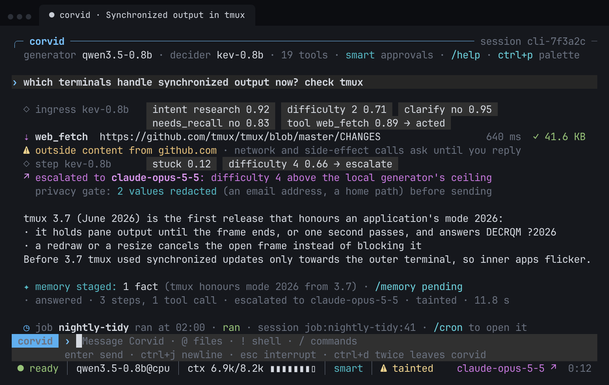
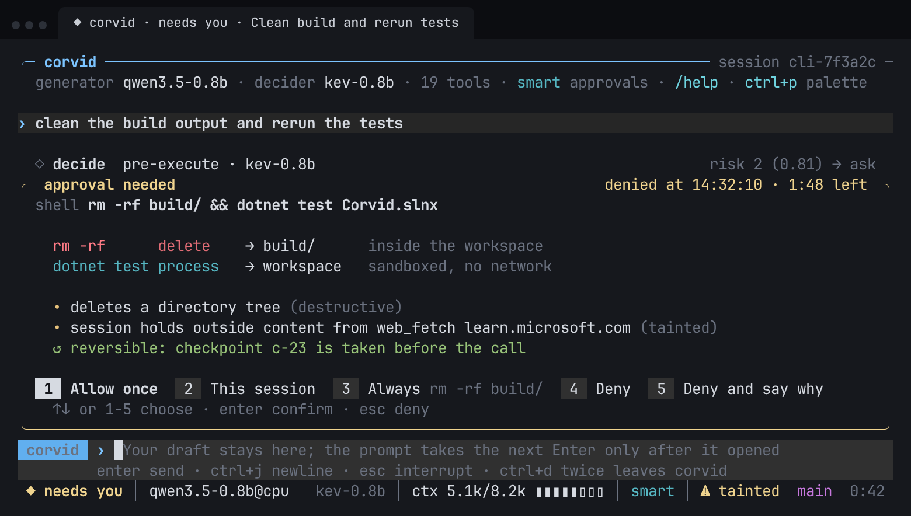
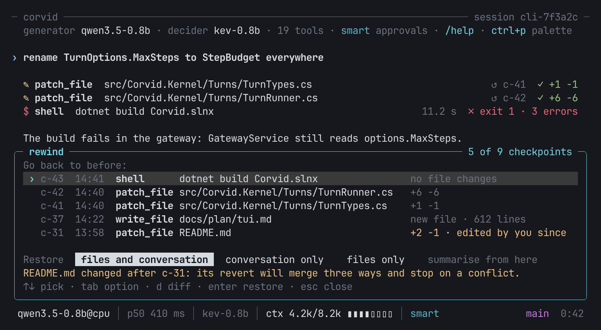

# Corvid

**A local-first .NET 10 agent that thinks small on your machine and writes big wherever you choose.**

Corvid is an agent in the spirit of Hermes Agent, built on [Starling](https://github.com/starlinghq/starling)'s in-process
models. It splits the work in two:

- **System One: the decision fabric.** Kev, GLiNER2 and the embedding models run in-process and make the many small
  calls an agent makes every turn: what the user wants, which tool fits, whether a step is risky, whether to escalate.
  These calls are local, fast and calibrated.
- **System Two: the generator.** A swappable model, local (Qwen3.5-0.8B by default, or any OpenAI-compatible server) or
  cloud (Anthropic, OpenAI, OpenRouter, Gemini), does the writing.

Secrets never enter the agent. They live in **Corvid Vault**, a separate process that runs no model and swaps
placeholders for real values only on the way out to the host each secret is bound to.

<p align="center">
  
  <br>
  <sub><i>Design mockup of the planned terminal UI (<a href="docs/plan/tui.md"><code>docs/plan/tui.md</code></a>). The agent behaviour shown is built: Kev's decisions, taint, escalation, the privacy gate, staged memory and cron runs. The renderer, the <code>@</code> and <code>!</code> shortcuts and the palette are the design; today's <code>corvid chat</code> uses a simpler Spectre.Console renderer.</i></sub>
</p>

## Contents

- [Quick start](#quick-start)
- [What Corvid does](#what-corvid-does)
- [Ways to talk to it](#ways-to-talk-to-it)
- [Configuration](#configuration)
- [Status](#status)
- [Build and test](#build-and-test)
- [Repository layout](#repository-layout)

## Quick start

Install the latest release (Linux x86_64; no .NET SDK needed):

```sh
curl -fsSL https://raw.githubusercontent.com/starlinghq/corvid/main/install.sh | sh
```

It puts `corvid` and `corvid-vault` in `~/.local/bin`, with `corvid-sandbox` beside them in
`~/.local/share/corvid/<version>/`, after checking the download against the release's `SHA256SUMS`. Add
`sh -s -- --cuda` for the CUDA variant (Kev on an NVIDIA GPU, about 300 MB more), `--version v0.1.0` for a given
release, or `--prefix <dir>` to install elsewhere. Running it again upgrades. Shell tools also need bubblewrap
(`pacman -S bubblewrap`, `apt install bubblewrap`). Then:

```sh
corvid doctor                # what is missing, and how to fix it
corvid model download qwen3.5-0.8b gliner2-base-v1 embeddinggemma-2 kev-0.8b
                             # the default models (about 10 GB); nothing downloads implicitly
corvid chat
```

Optional: `corvid model download kev-4b`, a second decision tier for gates (about 17 GB, 18 GB of RAM). Without Kev
downloaded, decisions run on the degraded tier and `corvid chat` says so.

From a source checkout, use `dotnet run --project src/Corvid.Cli -- <command>` in place of `corvid`, or build the
binaries yourself:

```sh
dotnet publish src/Corvid.Cli -c Release -r linux-x64        # a single-file `corvid`
dotnet publish src/Corvid.Cli -c Release -r linux-x64 -p:UseCuda=true -o out-cli-cuda
                                                             # the CUDA variant, for Kev on an NVIDIA GPU
```

Releases are cut by pushing a `v*` tag; [`release.yml`](.github/workflows/release.yml) builds both tarballs, installs
each with `install.sh` as a smoke test, and publishes them.

## What Corvid does

### Decides locally, writes wherever you choose

Each turn starts with Kev answering a catalogue of small questions: intent, difficulty, whether to clarify, whether recall
is needed, which tool. Kev's answers are calibrated against versioned floors. A confident answer acts. An unsure one asks
or escalates. Gate questions can go to a second tier, Kev-4B. A hard step can go to a bigger generator slot, local or
cloud. An embedding shortlist keeps the tool list the model sees short.

Kev answers a checkpoint in about a quarter of a second on an RTX 3090 and in a few seconds on a CPU
([spike S1](docs/spikes/S1-kev-latency.md)). On CPU-only hosts Corvid asks fewer questions: at most two per step, and no
per-call `risk` question where the outcome would be "ask" anyway.
→ [Decision fabric](docs/architecture.md#decision-fabric-c-004a) · [Kev decider](docs/architecture.md#kev-decider-c-004b) · [Kev on CUDA](docs/architecture.md#kev-on-cuda-c-029)

### Asks before it acts, and explains why



<sub><i>Mockup of the planned approval card. In today's CLI the same prompt is answered inline: once, this session, always, or deny.</i></sub>

Every side effect goes through a structural approval pipeline. It parses the shell command (a bash subset, with
wrappers such as `sudo`, `env` and `xargs` unwrapped), extracts every target, and checks the result against a hardline
deny list before any model is asked. In **Smart** mode a call runs unasked only when Kev rates it low risk and it stays in
the workspace, with no network, elevation or destructive tool. **Manual** mode asks for everything.

- **Taint.** Once outside content (a web page, an MCP result, a guest's message) enters the session, even network
  reads go through approval, and any network egress or send to a new recipient always asks, offering only "once".
- **Sandbox.** Shell commands run under `corvid-sandbox`: the workspace is writable, the rest of the system is
  read-only, credential stores are hidden, and there is no network unless allowed. Stdio MCP servers get a private
  workspace of their own. Allowed HTTPS goes through Vault's per-sandbox proxy, so a script can use a token it never sees.
- **Detection rules.** A built-in pack of twelve rules watches the session event log before every approval. Examples:
  a credential read followed by network egress, the environment or a credential file sent out, base64 in a request URL, a command you just denied
  proposed again. A match on an enforce rule always asks, whatever the mode or remembered approvals say.

→ [Approvals](docs/architecture.md#approvals-c-007b) · [Sandbox](docs/architecture.md#sandbox-c-007a) · [Detection rules](docs/architecture.md#detection-rules-c-023)

### Undoes its own work, not yours



<sub><i>Mockup of the planned rewind picker. Today the same restore is <code>/undo</code> and <code>/rollback N</code>.</i></sub>

Before any tool call that changes files, Corvid checkpoints the workspace into a shadow git store, which is never your
own repository. `/undo` reverts the last turn. `/rollback N` goes back to before the Nth latest checkpoint and takes
those turns out of the conversation too. If you edited a file since, the revert becomes a three-way merge, and a
conflict stops the restore so your edit is never overwritten. Checkpoints need `git` on `PATH`.
→ [Checkpoints](docs/architecture.md#checkpoints-c-014)

### Remembers, and learns skills it has proven

- **Memory.** Core blocks, episodic full-text search, a vector index and a bi-temporal fact graph, searched together.
  Writes are gated: a new fact is *staged*, and you approve it in `/memory pending`.
- **Lessons.** Per-project lessons sit between facts and skills, with a quality bar and review.
- **Skills.** Skills are [agentskills.io](https://agentskills.io) `SKILL.md` files in a git-versioned store, with
  authorship marked `user`, `agent` or `hub:<source>`. Corvid drafts a new skill from a successful task, replays it as
  a test, and saves it only if the replay passes. `~/.hermes/skills` and Hermes' `MEMORY.md`/`USER.md` import for review.
- **Compaction.** Long sessions compact into a structured record with map-reduce summaries. The standing `/goal` is
  re-injected, and `/compact <focus>` keeps what you name in full.

→ [Memory store](docs/architecture.md#memory-store-c-008) · [Lessons](docs/architecture.md#lessons-and-project-scope-c-025) · [Skills](docs/architecture.md#skills-c-017) · [Compaction](docs/architecture.md#compaction-c-016)

### Keeps secrets out of the agent

- **Vault-only keys.** Cloud model keys, MCP tokens and bot tokens are Vault secrets, each bound to its host. Corvid
  never reads keys from the environment, and without Vault cloud models are unavailable.
- **Privacy egress gate.** Requests to cloud models are redacted by default (PII and any credential value).
- **Credential scrub.** A token or password a tool returns is scrubbed before it reaches the event log, memory or any
  model. Memory and skills refuse one outright.
- **Poisoned MCP tools.** MCP tool definitions are pinned on first listing. A tool that changes later, or whose
  description reads like injected instructions, is held until you review it.

→ [Vault](vault/README.md) · [Cloud slots and privacy egress](docs/architecture.md#cloud-slots-and-privacy-egress-c-015) · [Credential scrub](docs/architecture.md#credential-scrub-at-the-event-log-and-memory-c-040) · [MCP pinning](docs/architecture.md#mcp-tool-pinning-and-poisoned-descriptions-c-022)

### Runs jobs on a schedule

`cron_create` and its siblings put durable jobs on a schedule. The scheduler wakes on a change or when a session opens,
and each job's run reports back where it was created, including a chat on the gateway. `/cron` lists jobs,
`/cron runs` shows their history, and you can pause, resume or remove one.
→ [Built-in tools and scheduler](docs/architecture.md#built-in-tools-and-scheduler-c-012)

### Leaves an audit trail

Everything a session does is an append-only SQLite event log, and the session state is a projection of it.
`corvid scan` runs the detection rules over the whole log afterwards. Add `--fail-on high` and it exits 4 on a
serious finding, which suits CI. `corvid traces export` writes sessions in the JSONL telemetry schema of
[Beacon](https://github.com/Asymptote-Labs/agent-beacon), so Beacon's detections and SIEM forwarding read Corvid like
any other agent. OpenTelemetry spans cover the rest.
→ [Session event log](docs/architecture.md#session-event-log-c-002) · [Trace export](docs/architecture.md#trace-export-and-hermes-memory-import-c-027)

### Built-in tools and slash commands

| Tools the model can call | |
| --- | --- |
| Files, confined to the workspace | `read_file`, `write_file`, `patch_file`, `list_files`, `search_files` |
| Shell and web | `shell` (sandboxed, approved), `web_fetch` |
| Memory | `memory_search`, `memory_add`, `memory_pending`, `memory_approve`, `memory_reject` |
| Schedule | `cron_create`, `cron_list`, `cron_pause`, `cron_resume`, `cron_remove` |
| Skills | `skill_list` and the skill tools |
| From MCP servers | `server__tool`, asking before each call unless the server is trusted |

| In chat | |
| --- | --- |
| `/help` `/status` `/tools` `/todos` | the commands, slots with device and latency, the tools with their risk, the session's todo list |
| `/model` `/model <slot>` | the generator's (or a slot's) models, numbered, with the current one and what each needs; type a number on the next line to switch |
| `/model [slot] <number \| name> [--pin]` | switch a slot for this session; `--pin` keeps it past escalation |
| `/goal [text \| clear]` | the standing goal, re-injected across compaction |
| `/approvals` | pending approvals and remembered approval rules |
| `/memory` `/skills` | review staged memory, lessons and skill drafts; import from Hermes |
| `/mcp` (`diff`, `accept`, `allow`) | servers, their tools, and held tool definitions |
| `/undo` `/rollback [N]` | revert the last turn, or go back to a checkpoint |
| `/compact [focus]` `/cron` | compact now; scheduled jobs and their runs |
| `/cancel` `/exit` | cancel the running turn; leave |

## Ways to talk to it

| Command | What it is |
| --- | --- |
| `corvid chat` | the terminal chat: streaming, a live tool panel, inline approvals |
| `corvid acp` | an [Agent Client Protocol](https://agentclientprotocol.com) agent on stdio for Zed, JetBrains and VS Code, with approvals as the editor's permission prompts (diff included) |
| `corvid serve` | an OpenAI-compatible endpoint (`/v1/chat/completions`, `/v1/models`) for Open WebUI and other front ends, loopback-only by default |
| `corvid gateway` | Telegram, Discord and Slack bots with pairing codes, an owner who answers approvals, and at-least-once delivery |
| `corvid mcp serve` | Corvid's memory search, skills and, optionally, project lessons offered read-only to another agent over MCP |
| `corvid mcp list` · `corvid doctor` · `corvid model` · `corvid scan` · `corvid traces export` · `corvid evals` | inspection and maintenance |

**Editors.** In Zed, add an `agent_servers` entry with `"command": "corvid", "args": ["acp"]`. Start it in the
workspace, because a session for another directory is refused.

**HTTP.** `corvid serve` listens on `http://127.0.0.1:8411`. To listen elsewhere, name a Vault secret as the bearer
token (`corvid-vault set serve.token`, with a random value of at least 24 bytes). Nobody can approve a tool call over
HTTP, so a call that needs approval fails the request with `approval_required`. With `Approvals: Deny`, the model
answers without the tool instead.

**Gateway.** Someone the configuration does not list gets a pairing code and nothing else until you approve it on this
machine: `corvid gateway pair` lists codes, `corvid gateway pair approve ABCD-EFGH --owner` pairs you, and `--guest`
pairs someone else, whose messages are treated as outside content. Only the owner runs commands and answers approvals.
Answers are recorded in a delivery ledger in the event log, so anything unsent goes out after a restart.
`corvid gateway status` shows adapters, pairings and waiting deliveries.
→ [ACP and HTTP](docs/architecture.md#acp-and-openai-compatible-http-c-019) · [Gateway](docs/architecture.md#gateway-c-020) · [Project memory over MCP](docs/architecture.md#project-memory-over-mcp-c-028)

## Configuration

Configuration is read from `$XDG_CONFIG_HOME/corvid/corvid.json` (section `Corvid`), from `CORVID__` environment
variables, or from `--set key=value`, and it is validated at start.
→ [Host and CLI](docs/architecture.md#host-and-cli-c-013)

<details>
<summary><b>Models: local, local-server and cloud slots</b></summary>

Remote models go under `Corvid:Models:Remote` and are named in slots like any other. A cloud key is a Vault secret
(`corvid-vault set anthropic.key`, bound to the provider's host).

```json
{
  "Corvid": {
    "Models": {
      "Remote": {
        "claude": { "Provider": "anthropic", "Model": "claude-opus-5-5", "Secret": "anthropic.key", "ContextWindow": 1000000, "AcceptedContext": 200000 },
        "qwen-27b": { "Provider": "openai-compatible", "Endpoint": "http://127.0.0.1:8080/v1", "Model": "qwen3.5-27b", "ContextWindow": 32768 }
      },
      "Slots": { "generator": { "Model": "qwen3.5-0.8b", "Escalation": ["qwen-27b", "claude"] } }
    },
    "Privacy": { "Cloud": "Redact" }
  }
}
```

Kev-4B is used only when configured: `--set Models:Slots:decider:Escalation:0=kev-4b`.
</details>

<details>
<summary><b>Kev on the GPU</b></summary>

Use the CUDA build variant. It needs the NVIDIA driver and the CUDA 13 runtime, and `corvid doctor` checks for both.
Place Kev on the GPU:

```sh
corvid chat --set Models:Placement:kev-0.8b:Device=cuda --set Models:Placement:kev-0.8b:Fallback=Cpu
```

or `"Models": { "Placement": { "kev-0.8b": { "Device": "cuda", "Fallback": "Cpu" } } }` in the file. With
`Fallback: Cpu`, Kev runs on the CPU, with a notice, when the GPU cannot be used. The default `Fail` leaves decisions on
the degraded tier instead. Build the two variants into separate output directories
([details](docs/architecture.md#kev-on-cuda-c-029)).
</details>

<details>
<summary><b>MCP servers</b></summary>

```json
{
  "Corvid": {
    "Mcp": {
      "Servers": {
        "notes": { "Command": "notes-mcp", "Arguments": ["--stdio"], "ReadOnlyPaths": ["~/notes"] },
        "tracker": { "Url": "https://mcp.tracker.example/mcp", "Secret": "tracker.token", "Trust": "Trusted" }
      }
    }
  }
}
```

Servers are untrusted by default: every tool asks before it runs, and its description and every result taint the
session. `"Trust": "Trusted"` honours a server's read-only hints. Review held tools with `/mcp diff`, then take them with
`/mcp accept`, or with `/mcp allow` for a flagged one, which then always asks. `"Corvid:Mcp:Serve:ProjectMemory": true`
adds `get_memory` and `get_memory_context` to `corvid mcp serve`, serving approved lessons only, never local-only ones.
([details](docs/architecture.md#mcp-client-and-server-c-018))
</details>

<details>
<summary><b>HTTP endpoint</b></summary>

```json
{ "Corvid": { "Serve": { "Url": "http://0.0.0.0:8411", "TokenSecret": "serve.token", "Approvals": "Fail", "Tools": true } } }
```
</details>

<details>
<summary><b>Messaging gateway</b></summary>

```json
{
  "Corvid": {
    "Gateway": {
      "Adapters": {
        "telegram": { "Enabled": true, "Secret": "telegram.bot", "Owners": ["123456789"] },
        "discord": { "Enabled": true, "Secret": "discord.bot", "Channels": ["1180000000000000000"] },
        "slack": { "Enabled": true, "Secret": "slack.bot", "AppSecret": "slack.app", "HomeChat": "C0123456789",
                   "Chats": { "C0123456789": { "Persona": "Answer briefly.", "Slots": { "generator": "claude" } } } }
      }
    }
  }
}
```

In `vault.json`, bind each token to its API host (`api.telegram.org`, `discord.com`, `slack.com`) and toolset `gateway`.
Allow `POST` as `auto`, because sends carry no approval. Telegram's token goes in the URL path, so it needs
`"allowInUrl": true`. Under the default `"tainted": "ask"`, answers from a tainted session, such as a chat with a guest,
are refused. Set `"tainted": "auto"` on a token only if guests should get answers.
</details>

<details>
<summary><b>Detection rules, scans and trace export</b></summary>

```sh
corvid scan --fail-on high                     # whole log; --session <id> for one, --json for one document
corvid chat --set Detections:Enforce=false     # record every match without asking
corvid traces export --session <id> --out trace.jsonl
```

`Corvid:Detections:Enforce=false` records matches without asking, so scheduled jobs never stop on a rule.
`Corvid:Detections:Enabled=false` turns the inline check off. Trace export redacts secrets and cuts long strings at
4 KiB. `--retention metadata` keeps names, paths, commands and decisions but no content. Memory tool content is
withheld unless `--include-local-memory` is given. `--out` writes an owner-only file and never overwrites one.
`/memory import hermes [<hermes home>] [--dry-run]` stages Hermes memories for review, and nothing is written until you
approve it.
</details>

## Status

Pre-release and Linux-first.

**Built:** everything above, plus calibration tooling with decision export, the golden-trajectory replay harness, the
S2 tool-calling golden set and harness, spike S4's harness comparing Kev's `tool` and `done` answers with the
600-token state against a transcript-sized one ([S4](docs/spikes/S4-state-budget.md)), and a prompt-injection
exfiltration canary suite. The full list is in
[`docs/architecture.md`](docs/architecture.md), one section per work item.

**Next:** the terminal UI redesign in [`docs/plan/tui.md`](docs/plan/tui.md). The mockups above and the rest in
[`docs/plan/tui-mockups/`](docs/plan/tui-mockups/README.md) come from it. The plan has an inline renderer that never
clears your scrollback by default, with fullscreen and screen-reader modes on one component model. The overall roadmap
is [`docs/plan/corvid-agent.md`](docs/plan/corvid-agent.md), and Vault's is [`docs/plan/vault.md`](docs/plan/vault.md).

## Build and test

Requires the .NET 10 SDK (10.0.401 or a later feature band). The Vault tests are Linux-only.

```sh
dotnet build Corvid.slnx
dotnet run --project tools/Corvid.Architecture --no-build -- .   # dependency-boundary check
dotnet test --solution Corvid.slnx
```

Evaluation harnesses (replay, calibration, tool-calling) are described in [`evals/README.md`](evals/README.md).

## Repository layout

| Directory | Contents |
| --- | --- |
| `docs/plan/` | the agent plan (`corvid-agent.md`), Vault (`vault.md`), and the TUI design (`tui.md`) with its mockups |
| `docs/architecture.md` | how each built piece works, section by section |
| `docs/spikes/`, `docs/research/` | measured spikes (S1 to S5) and the TUI research notes |
| `src/Corvid.Abstractions` | dependency-free contracts: session events, `IEventLog`, `Envelope`, `IDecider`, `IExtractor`, `ITokenCounter` |
| `src/Corvid.Kernel` | event log and projections, session actors and the turn loop, compaction, durable jobs and the scheduler, checkpoints |
| `src/Corvid.Fabric` | decision fabric: question catalogue, versioned floors, policy, the degraded decider, the tool shortlist, Kev-4B escalation |
| `src/Corvid.Models` | model slots, profiles and switching; the privacy egress gate and the Vault-only HTTP pipeline |
| `src/Corvid.Models.Starling` | in-process Starling adapters: Qwen3.5-0.8B, GLiNER2, EmbeddingGemma 2 and e5, Kev-0.8B and Kev-4B |
| `src/Corvid.Models.Anthropic`, `.OpenAICompat` | cloud and local-server providers |
| `src/Corvid.Approvals` | bash-subset parser, target extraction, hardline deny list, approval modes and rules |
| `src/Corvid.Rules` | detection rule format, evaluator and the built-in pack |
| `src/Corvid.Secrets` | credential-value detector and the credential scrub |
| `src/Corvid.Memory` | memory store and per-project lessons |
| `src/Corvid.Skills` | `SKILL.md` loader, git-backed skill store, imports, the learning loop, curator and skill tools |
| `src/Corvid.Tools`, `.Tools.Builtin`, `.Tools.Generators` | tool attributes and registry, the built-in tools, the `[Tool]` source generator |
| `src/Corvid.Mcp` | MCP client and server, tool-definition pins and the poisoned-description scan |
| `src/Corvid.Host` | composition root: configuration, slots, runtime, slash commands, `doctor`, OpenTelemetry |
| `src/Corvid.Cli` | the `corvid` command |
| `src/Corvid.Acp`, `src/Corvid.Http` | the editor (ACP) and OpenAI-compatible front ends |
| `src/Corvid.Gateway` (+ `.Telegram`, `.Discord`, `.Slack`) | the messaging gateway and its adapters |
| `src/Corvid.Vault.Contracts`, `.Vault.Client` | the wire contract with Vault, and Corvid's side of it (`VaultClient`, `VaultHandler`, `SecretRef`) |
| `vault/Corvid.Vault` | `corvid-vault`, the secrets process ([README](vault/README.md)) |
| `sandbox/` | `corvid-sandbox`, the launcher for shell commands and stdio MCP servers |
| `evals/` | golden trajectories, the replay and calibration harnesses, the tool-calling golden set, spike code and results |
| `tools/Corvid.Architecture` | resolved dependency-graph checker |
| `tests/` | unit, scenario and regression suites for every project above, including Vault's S6 |
